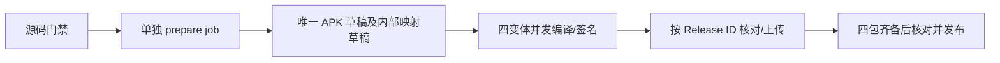

# 构建发布脚本：共享草稿并发竞争修复

用户要求先发布 5.3.0-preview.4，再彻底处理最近反复卡住的构建发布脚本。

## 本次发布恢复

[构建 45112363035](https://github.com/leotvgo/Leotv/actions/runs/45112363035) 首次尝试的四套 APK 编译、原样/变化审计、固定签名和 R8 映射归档都已成功。Actions 存储不可用后，两个 TV 任务并发执行“先查有没有草稿，再创建”；GitHub 接受了同名 APK 草稿 `454989257` 和 `454989266`。TV 文件最终进入前者，后者为空；随后手机归档发现两份同名草稿而拒绝继续。自动发布因此跳过。

核对两份草稿都是同源码 `21bced7e4ed42f2e73f9b08b0f2173835a9fc19b`、均未发布，主草稿有完整六个 TV 文件、重复草稿无资产后，将空草稿按精确 ID 保留为 `leotv-5.3.0-preview.4-build-45112363035-duplicate-454989266`，没有删除文件。重跑失败任务后第二次构建成功，[发布 45114111040](https://github.com/leotvgo/Leotv/actions/runs/45114111040) 成功，四套固定签名 APK 已发布到 [5.3.0-preview.4](https://github.com/leotvgo/Leotv/releases/tag/leotv-5.3.0-preview.4-build-45112363035)。

## 脚本修复

- `tools/prepare_ci_release.py` 是唯一创建共享草稿的入口，执行在并发 matrix 之前。原“先查询再创建”的过程不再分散到两个 runner；已存在的同源码草稿直接复用。模糊的创建失败响应先查服务器，不盲目再次创建。
- `tools/stage_ci_apk.py` 不再创建草稿，只取预建对象并核对源码、签名、审计。缺少准备结果时明确失败，不把错误扩大为多份同名草稿。
- `tools/ci_release_store.py` 按已核对的 Release ID 上传，避免再次按 tag 选择错误对象；每个文件按大小、上传状态和 SHA-256 核对。一致文件跳过上传，连接中断后先查看是否已接收完整文件；摘要暂未可见时等待再核对。
- 只恢复同源码未发布草稿中的不完整文件。已发布文件不一致时拒绝覆盖，内部 R8 映射始终要求私有草稿。
- 网络超时及 HTTP 429/500/502/503/504 有有限重试和超时；认证失败及源码不一致明确停止。重试不会无限等待，也不会绕过固定证书或原样审计。
- `prepare` job 必须先通过归档恢复测试；发布流程已有的完整四包、固定证书、摘要、版本、正式 R8、重复发布保护及保留最近十个测试版本的检查保持。

## 验证

14 项虚构 GitHub 归档测试覆盖：唯一预建、重复执行、创建已成功但响应失败、重复 tag、源码不一致、映射草稿保护、Release ID 上传、上传成功但响应失败、摘要延迟、草稿中断恢复、公开文件不可覆盖、超时重试、认证失败及依赖顺序。原有 11 项发布保护测试通过。

另以新的 GitHub 整轮构建验证真实 Actions 存储不可用时的备用上传、四变体固定签名、自动发布，并核对重复发布前后的资产 ID/摘要。真实结果记入交付证据，不把仅通过模拟测试当作发布问题已解决。此次脚本修复不改 APK 功能或版本号。

实际验证已完成：脚本提交 `42578a10f8fc962d8f86d0762213a9532a463fa8` 的[构建 45115729423](https://github.com/leotvgo/Leotv/actions/runs/45115729423) 和[自动发布 45116306936](https://github.com/leotvgo/Leotv/actions/runs/45116306936) 首次尝试成功，四个变体都实际使用了备用 Release 上传。prepare 完成后 matrix 才启动。再次执行准备两次，复用了相同两个 Release ID，没有创建新草稿；[重复发布 45117153172](https://github.com/leotvgo/Leotv/actions/runs/45117153172) 成功，12 个已发布资产的 ID、大小和摘要均保持一致。四个固定证书/签名报告、原样与允许变化审计和私有映射摘要通过核对，正式 Latest 保持 5.2.3。

最终[四套 5.3.0-preview.4 APK](https://github.com/leotvgo/Leotv/releases/tag/leotv-5.3.0-preview.4-build-45115729423) 与取证 `evidence/leotv-5.3.0-preview.4-delivery-20261123.json` 已保存。
