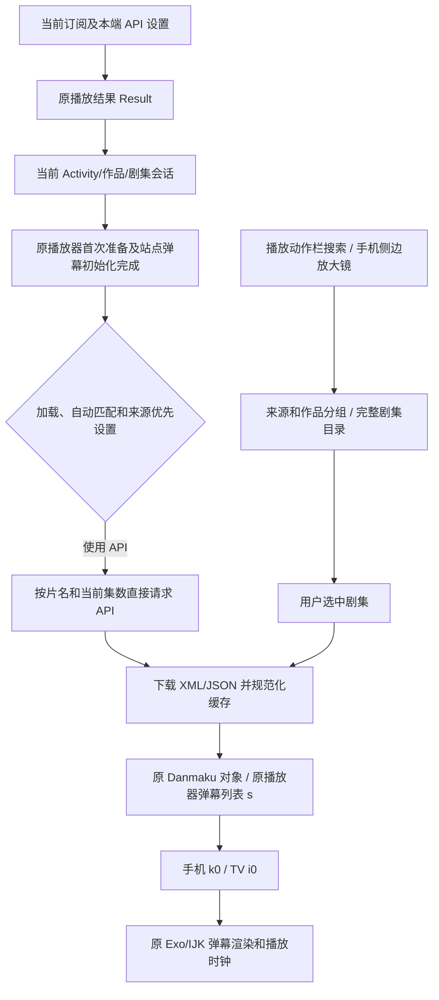

# 弹幕完整链路、FongMi 对照与手机原生搜索胶囊

本轮基于用户对 5.3.0-preview.3 的反馈，只修复手机侧边放大镜缺失、搜索选集不完整、自动加载被中断，以及用户明确提出的换站后恢复原搜索胶囊时序。设置项和来源优先策略保持现状；FongMi 新设置只作对照，不直接增加。用户要求“不要自行新增或删除功能”已写入 AGENTS.md。

## 搜索胶囊的来源

原普通手机 APK 已有 `layout/fragment_vod` 顶栏：`searchInput` 是带 `selector_item_round` 背景的 LinearLayout，内部是热门词 `hot` 和放大镜 `search`；独立的 `searchIcon` 是站点文字状态的另一个搜索按钮。原 `title` 默认隐藏、`searchInput` 默认显示。

新主页接回这组原控件的提交是 `3eb537a5`，2026-11-22 11:58:11（5.2.0-preview.3）。该提交让每次借用顶栏都强制显示 title、隐藏 searchInput，原宿主的后续回调又能恢复搜索胶囊，造成首次进入与换站后的显示不一致。它不是本次弹幕版本新创建的搜索功能。

按用户这次明确提出的行为，首次挂接显示原搜索胶囊；换站显示站点名 4 秒，再隐藏站点名、恢复胶囊。胶囊与独立搜索图标互斥，沿用原点击事件、热门词、背景和 logo 切站。归还顶栏时撤销本轮延时回调并恢复借用前状态。

## 壳内当前链路

壳直接发 HTTP 请求并调用本 Activity 的播放器接口，未使用 JAR 的本机 HTTP 推送、网页选择回推或播放器反射扫描路线。JAR/站点在 Result 中提供的原弹幕仍属于站点来源，原选择列表和文件选择保持。

API 优先级为本端手动配置高于当前订阅根级 `danmaku`。自动匹配需要“加载弹幕”和“自动匹配”开启、有有效 API，且当前会话已完成原生首次准备。“站点弹幕优先”开启且 Result 已带来源时，壳保持站点弹幕，不再自动搜索；手动搜索仍可选择 API 来源。匹配记忆隔离到订阅/API、站点、作品、剧集及地址。

每次换集、刷新、换引擎作废旧请求；结果必须仍属于同一 Activity、作品、剧集及 API 才能落入播放器。用户主动选择原来源会接管当前弹幕，后续旧 API 回调不能覆盖它。

## 已定位并修复的缺陷

| 反馈 | 实际原因 | 修复 |
| --- | --- | --- |
| 手机左侧没有放大镜 | 原侧边父容器是 `androidx.appcompat.widget.LinearLayoutCompat`，旧代码只接受 `android.widget.LinearLayout`，直接跳过 | 核对真实父容器方向，使用 ViewGroup 和原 LayoutParams 的复制构造加入已要求的图标 |
| 搜索只见首集或缺少完整选集 | 手动分支只调用扁平 Fongmi 接口且传空集数；未读取 `animes/episodes/bangumi` 目录及显式 episodeId/episodeNumber | 已识别的标准 v2 地址读完整搜索目录，分组必要时按 bangumiId 取剧集；按 episodeId 请求 comment XML；通用/模板地址回退原协议并传当前集数 |
| 自动加载要打开搜索界面后才工作 | 原 `onPlayerEvent` 首次准备会选站点首项或空弹幕，旧监听误判为主动选择并 cancel 自动任务 | 将这一个已锁定调用标记为原生初始化；自动匹配等待 Result 与首次准备都完成。主动原生选择仍取消 API 任务 |
| 换站后搜索胶囊消失 | 借用顶栏每次固定显示站点文字，未维护原搜索状态 | 按用户要求恢复首次及换站后的时序 |

目录的来源、作品 ID 和剧集编号保持，不把作品首集伪装成全部选集；详情返回省略作品标题/ID 时沿用搜索所属分组。只有提供标准剧集目录能力的 API 能展开完整目录；任意自定义接口仍取其实际返回项。

## FongMi 当前完整调度与兼容边界

对照固定版本：[FongMi/TV e7e7dd06250ca53da3c594ca4f6befc02e56b1d1](https://github.com/FongMi/TV/tree/e7e7dd06250ca53da3c594ca4f6befc02e56b1d1)。31 份源码/XML、服务协议参考及 SHA-256 保存于 `evidence/fongmi-danmaku-20261123/source-index.json`。2026-04-15 的原比较基线继续保留。

FongMi 的 VideoActivity 将当前 Result、History 和 Episode 交给 `VodPlaybackMedia.searchDanmaku`。它检查加载/自动开关、有效 API 和站点开关，按 history.getVodName 与 episode.getName 请求 `DanmakuApi`，只接受仍属当前播放的结果。开启站点优先且已有站点弹幕时把 API 候选加入列表，否则直接选择 API 弹幕。这个“仍搜索并加入候选”的策略与壳目前“有站点弹幕便跳过自动 API”不同，本轮未擅自改变壳的策略。

手动路径为播放弹幕按钮 → `DanmakuDialog` → 搜索/文件/设置。Dialog 观察当前 PlayerManager，搜索页从媒体 metadata.title/artist 取得作品和集数；请求后展示返回列表，选择项时再次检查当前播放器，再调用 setDanmaku。文件选择会暂停原播放器；菜单原来源选择通过 toggleDanmaku。退出或播放器失效后取消窗口请求。

| FongMi 当前设置/UI | 当前普通 APK 的实际支持 | 本轮处理 |
| --- | --- | --- |
| API、加载、自动匹配、站点优先 | 壳已有对应配置和原来源列表 | 保持当前设置项，修复请求时序和选集 |
| 外观：字号、透明度、粗体、字体、描边/阴影、颜色 | 原 master.flame 渲染器已接字号/透明度；其它项没有当前已验证接线 | 不直接移植新的控制项 |
| 时序：偏移、滚动停留时长、固定停留时长 | 壳已有文件偏移与原速度档位 | 保持现有偏移/速度；不把新时长键写入旧速度键 |
| 密度：同屏总数、屏幕比例、间距、滚动/顶部/底部行数 | 原 `danmu_line` 控制行数，未接新密度模型 | 保持原行数设置 |
| 显示：滚动、顶部、底部、反向、定位、字幕、特殊弹幕 | 原总显示开关及原解析/渲染行为 | 保持总显示开关，不增加未接线的过滤项 |

FongMi 新设置面板依赖 `androidx.media3.ui.danmaku.DanmakuConfig`、PlayerManager.setDanmakuConfig、新字体/MPV 集成等，当前原包用 master.flame 以及 `H3.d/E3.d`。因此不能把新面板 Java/XML 直接编入旧包或仅改 minSdk；需要逐项适配真实渲染器并获得用户对新增项的明确同意。本轮未迁移新面板或替换播放器。

## 验证

四变体精确源码路径、原生 ABI 和按实际顺序的 smali 挂接已检查。手机32位、TV64位完成 API23、R8 release/full、原样及允许变化审计；均为本地未签名验证包，版本号保持现有预览版本，没有发布新版本。针对目录/剧集 ID、当前集数请求、首次准备与主动切源、首页搜索时序的 API23 检查分别运行手机/TV 配置。

使用虚构作品、虚构 API 和本机临时 HTTP 服务，未读取实际用户配置或凭据。真机放大镜可见性、实际服务返回、播放同步、换集及遥控仍需签名后验收。最终验证明细见 `evidence/leotv-danmaku-chain-repair-20261123.json`。

## GitHub 交付

用户在本地修复完成后要求推送 GitHub 编译 APK。本次交付版本为 5.3.0-preview.4 / 616，保持测试预发行、固定签名和 TV/手机双 ABI；新增设置项和来源优先策略保持原状。GitHub 关闭额外回归，继续执行必须的四变体源码门禁、API23/R8、原样与允许变化审计及固定签名核对，成功后自动发布。
