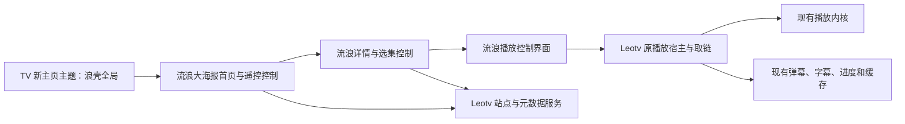

# TV「浪壳全局」大海报首页、详情与播放交互迁入研究

2026-11-28。用户限定 **TV 端**，并明确选择流浪壳的 **大海报新首页**，入口拟放在「个性设置 → 新主页主题 → 浪壳全局」。本轮完成 APK、资源、字节码和 Leotv 当前接入点研究；没有实现应用功能、构建 APK、推送或触发发布。

## 结论与范围

**可行，适合增加一套可选的 TV 点播交互模式。** 大海报首页、详情布局、焦点导航、选集与播放控制可以按流浪壳的实际实现迁入，再连接 Leotv 的站点、取链、播放器、弹幕和数据组件。它涉及三个页面及其状态交接，不能只在现有首页主题枚举中增加名称和几项布局参数。

目标是首页 → 详情 → 全屏播放的连续体验，包括分类筛选、海报焦点反馈、页面过渡、换源、选集、续播、播放菜单和返回焦点。这里的「全局」以用户指定的三个点播页面为范围；直播、设置、下载等独立页面的改版没有包含在本轮要求中，原有入口应继续可用。

目前掌握的是 APK 和反编译材料，尚未确认这两个 APK 对应的完整可编译源码。已经确认的代码和 XML 足以继续恢复具体模块，但不能把阅读输出当作可直接合入的源码，也不能以静态分析保证最终显示效果、流畅度或 Android 6 运行效果。

## 样本与实际实现

原文件在项目同级目录：

- `../流浪壳32位261124.apk`，SHA-256 `139dfc45a5496156fab6a20d712bb8a38e84a6ac894d9bb0841ce351006ba882`。
- `../流浪壳64位261124.apk`，SHA-256 `432420be33f9f6096ae8ba13abc97f27c900ea3cfe2b87e97527b9f4949997dc`。

两者包名 `com.fongmi.android.tv`，版本 `5.5.6-20261124 / 20261124`，minSdk **24**、targetSdk **28**。Leotv 保留 minSdk **23**。APK 的 `new_ui` 默认开启；原 `HomeActivity` 会转到 `HomeActivityV2`，后者就是本次选定的大海报首页。

| 部分 | 已定位的实现 | 可见结构与行为依据 |
| --- | --- | --- |
| 新首页 | `HomeActivityV2`、`activity_home_v2`、`pr3` | 全屏背景、左/下渐变、左侧作品信息和艺术字、顶部导航、分类条、横向海报列表、筛选浮层及内嵌历史面板 |
| 背景显示 | `HeroImageView`、`gi3`、`nh2` | 当前卡片驱动背景和信息更新；无背景时回退竖海报；邻近图片预取和请求撤销 |
| 详情 | `DetailActivity`、`activity_detail`、`ou0`、`zn0`、`xh0` | 延续大海报与作品信息，播放/收藏/换源按钮，下方线路和选集，分组与排序操作 |
| 全屏播放 | `VideoActivity`、`view_widget_vod`、`view_control_vod`、`view_control_vod_action` | 进度条、上一集/下一集、选集、解析、内核、解码、倍速、比例、字幕/音轨、片头片尾等控制；遥控和返回按当前浮层状态处理 |
| 取链与状态 | `qx3`、`sx3`、`ou3`、`rx3` | 连接 Result、History、Flag、Episode、播放响应、换集和预加载，详情也复用该控制契约 |

以下是与迁入直接相关的实际行为：

1. **首页随焦点换背景。** `M2/N2` 更新当前卡片的标题、简介、艺术字和背景；部分图片/信息任务延迟约 200–250ms 调度，避免快速横移时立即处理每一个经过项。邻近窗口为当前位置前后各两项。迁入目标应保留这套选择与加载时序，而非继续用 Leotv 当前首分类轮播代替。
2. **分类不是现有纵向分组首页的换皮。** 流浪壳使用顶部导航、分类和横向海报行；`c2/y2` 处理分类缓存、分页、去重、空列表和筛选。首页返回会先处理历史面板、筛选、目录等状态，最终才进入退出逻辑。
3. **详情有独立的遥控规则。** 上下键在操作按钮、线路、分组和剧集之间移动；剧集网格左右边界可切换前后分组并选择对应行。`q2` 根据布局模式使用 6 或 24 的分组大小；这些是交互规则，不等于每行列数。
4. **详情直接启动独立播放页。** `DetailActivity.p2` 向 `VideoActivity` 传 `key/id/name/pic/flag/mark`，还传 `cast=true`。Leotv 当前使用自己的全屏标志和已加载详情交接，不能原样复制这个 Intent：字段相同不代表对应宿主版本的分支语义相同。
5. **播放页存在多层返回。** `VideoActivity.G1/dispatchKeyEvent` 先处理选集或控制浮层，再根据全屏启动等状态退出或恢复布局。需要连同焦点记录一起迁入，不能只复制按钮和进度条。

## Leotv 的接入方式

现有 `HomeTheme` 只控制 `CspHomePage` 的海报区域呈现，TV ID 为 0–4，手机独立映射 0/3/4。`MetadataSettings` 保存 `new_home_theme`，详情另有自己的主题。`NewHome` 负责现有首页挂载、生命周期、分类与请求取消。`NativeRouting` 将资源入口统一送到 Leotv 详情；`Playback` 负责已加载详情交接、原生全屏播放器、弹幕、作品进度和预加载。

建议使用下面的结构，名称为规划名称，尚未创建这些应用类：

- **选择与路由：** TV 追加稳定主题 ID，例如 5，旧 ID 不重排。单独判断 TV 浪壳模式，在新主页开启时接管三个页面；详情显示随该模式走，但不覆盖用户已保存的其他详情主题值。选择其他主题后仍可恢复原选择。手机不增加该选项。
- **首页：** 将流浪首页恢复为独立 TV 页面控制模块，沿用原 XML 的结构、焦点和动画规则；数据经 Leotv `SiteFeed/CspHomeData` 等适配。把推荐、分类、筛选、目录、分页及历史入口接齐，避免留在原首页执行路径中相互抢焦点。
- **详情：** 恢复流浪详情呈现和选集状态机，通过 `SourceGateway`、现有换源和 `DetailSessionCache` 获取实际详情。保留真实线路/第二层路径、剧集地址、排序、续播和失效提示的既有契约。Leotv 已有演员、剧照、评论、推荐、追更等能力仍需保留可达入口，不能因流浪原布局没有同样区域就删除。
- **播放：** 优先保留 **Leotv 原 `VideoActivity` 及其播放宿主**，在浪壳模式中安装迁入的控制布局和遥控状态机，通过专门桥接层调用现有播放动作、消费状态回调。这样能继续使用原 System/IJK/Exo 及 TV 完整版的 VLC；基础版仍按现有内核档位交付。MPV 是当前手机路径，不因本次 TV UI 研究新增 TV MPV。
- **全局入口：** 除首页外，搜索结果、收藏、历史/最近观看、追更及相关作品等通往详情/播放的入口也要服从模式路由；若只接首页点击，就无法达到用户要求的整套点播交互。
- **切换与退出：** 新旧首页不能同时挂载或接收方向键。退出模式时取消请求、定时器和动画，释放背景引用与监听，恢复现有首页；播放会话携带明确模式，不在播放中途因偏好变化重建 Surface 或丢失当前进度。

不建议把流浪的完整 DEX、同名 Activity 或整个播放器依赖树装进当前 APK。两者共用大量包名和模型名称，但 R8 成员、资源编号和播放器契约不同；直接复制会同时引入冲突与隐含功能变化。新恢复的业务类使用 Leotv 独立命名，资源单独前缀并重新映射编号，底层服务由适配器连接。

## 迁入前需要解决的具体问题

**Android 6：** 已在首页原字节码中发现直接调用 `ConcurrentHashMap.newKeySet`、`computeIfAbsent`、`HashMap.getOrDefault`，均需要 API 24。需要用 API 23 可用的实现或经过核对的回移契约恢复，不能只改 Manifest 的 minSdk。现有 `java.util.function`、`j$` 层和两种 ABI 的原 native 库继续保留。

**反编译恢复：** 本次普通 JADX 阅读输出中，首页 3、详情 2、播放页 5、`qx3` 1 个方法没有完成结构化恢复。包含首页/播放页 `dispatchKeyEvent`、详情 `u2` 等关键方法。首页另生成 simple 模式指令阅读视图用于核对；其中的 goto 和局部类型不是可编译源码。实现时必须按原 smali 恢复关键分支与回调，不能保留 `UnsupportedOperationException` 占位或猜测动作。

**播放与弹幕：** 流浪播放页使用 `androidx.media3.ui.PlayerView/PlayerSeekView` 和自己的回调契约；Leotv TV VLC 桥接直接依赖现有原生宿主类型与状态字段。复制流浪整个 `VideoActivity` 会绕开现有桥接。需要保留媒体 Surface、取链/解析响应、请求头、DRM、字幕和播放时钟，只迁入控制界面与交互；弹幕搜索、自动匹配、字号/样式/特效、暂停/缓冲/跳转时钟继续使用 Leotv。

**重复控制：** 流浪 `qx3` 已经包含取链、History、下一集与预加载控制，Leotv 也有对应能力。应明确每项行为由哪个服务执行，避免两个控制器同时取链、切集、存进度或预加载。可迁入选集与菜单的决策规则，但服务动作只执行一次。

**构建审计：** 当前 `check_home_themes.py` 明确要求普通主题只影响首页海报、保留已回退的分类布局。本次新增模式不能简单放宽所有主题的门禁；需要独立的 TV 模式声明、路由和生命周期门禁，保留其他主题与手机原要求。最终列出准确的新增/允许变化类、资源及 Manifest 范围，继续通过实际源码/API23/R8/原样与变化/native/固定签名核对。

## 实施顺序与证据边界

建议先恢复首页、详情、播放控制的关键方法和资源契约，确定桥接边界，再依次完成三个页面和全部入口，最后处理模式切换及请求释放。阶段是开发顺序，最终交付范围仍是完整三页交互，不能以首页外观完成代替整体迁入。

完成实现后的真机验收应覆盖：首页长按/分类筛选/快速横移、详情线路与跨分组选集、换源与已有进度、播放浮层/返回/切核、弹幕暂停与跳转、退出主题后的原页面恢复。仍按用户规则直接 GitHub 构建并保留必需审计，运行效果由用户 TV 真机验收；本轮未执行这些运行验证。

已对两个原 APK 的 **24 个选定界面/控制/元数据类** 使用 `DexSemanticAudit` 比较代码、字段和注解语义：24/24，0 个变化。两个 APK 的 **14 项选定布局/遮罩/按钮资源** ZIP 字节也逐项相同。这说明本次选定迁入样本可以采用一套共同的 UI 恢复参考，不是两个完整 APK 的一致性证明，也不是 Android 6 兼容证明。

- [样本、类/方法索引、资源 SHA 与当前 Leotv 源码快照](../evidence/liulang-tv-global-ui-research-20261128.json)。记录当前 HEAD `84e2cce4c5a7cfb21518339b4f68d0489fe41b75` 及相关工作区文件 SHA；工作区有本轮之前的未提交修改。
- [24 类双 ABI 语义比较](../evidence/liulang-tv-ui-selected-abi-comparison-20261128.json)。
- [此前 TMDB 研究](LEOTV-LIULANG-TMDB-RESEARCH-20261125.md)及[已落实的加载优化](LEOTV-5.3.2-TMDB-LOADING-20261125.md)：当前服务层已吸收部分加载机制，迁入 UI 时应复用当前实现。
- 本轮阅读材料位于 `research/liulang-261124/ui-research-20261128/`，资源阅读位于 `research/liulang-261124/ui-res-20261128/`，均按精确目录忽略，保留在本地，未加入应用源码或构建输入。
